# Cloud Computing & DevOps (CCA-2) CI/CD Project

> **Institution:** MIT World Peace University (MIT-WPU), Pune  
> **Course:** TYCSE &bull; Cloud Computing and DevOps  
> **Assessment:** Continuous Comprehensive Assessment 2 (CCA-2) &bull; **Total Marks: 10**  
> **Course Coordinator:** Priya Nagargoje  
> **Student Name:** Aryan  
> **GitHub Repository:** [https://github.com/Eclipse1911/cca2-cicd-project](https://github.com/Eclipse1911/cca2-cicd-project)  
> **Live EC2 Deployment IP:** `13.235.86.28` (NodePort: `30080`, Jenkins: `8080`)  

---

## 📋 Executive Summary & System Architecture

This repository contains a full-stack, automated CI/CD pipeline and cloud-native web application built for the CCA-2 assessment. It demonstrates continuous integration, automated unit testing, containerization with Docker, push to Docker Hub registry, and zero-downtime rolling deployment on Minikube Kubernetes on AWS EC2.

```mermaid
flowchart LR
    A["Developer<br/>(Git Commit)"] -->|"git push origin main"| B["GitHub Repository<br/>(Eclipse1911/cca2-cicd-project)"]
    B -->|"Webhook / Poll SCM"| C["Jenkins on AWS EC2<br/>(Ubuntu 24.04 / 22.04)"]
    
    subgraph Jenkins_Pipeline ["Declarative Jenkins Pipeline (Jenkinsfile)"]
        C1["Stage 1: Checkout SCM"] --> C2["Stage 2: Build & Test (npm test)"]
        C2 --> C3["Stage 3: Docker Build (BUILD_# & latest)"]
        C3 --> C4["Stage 4: Push to Docker Hub"]
        C4 --> C5["Stage 5: Minikube Deploy (kubectl set image)"]
        C5 --> C6["Stage 6: Verify Deployment Rollout"]
    end
    
    C --> Jenkins_Pipeline
    C4 -->|"docker push"| D["Docker Hub Registry<br/>(docker.io/eclipse1911/cca2-app)"]
    C5 -->|"kubectl apply & rollout"| E["Minikube K8s Cluster<br/>(2 Replicas / Rolling Update)"]
    E -->|"NodePort 30080"| F["Evaluator Browser<br/>(http://13.235.86.28:30080)"]
```



---

## 📂 Repository Layout

```text
├── app/
│   ├── public/
│   │   ├── index.html        # Interactive Cloud & DevOps curriculum dashboard UI
│   │   ├── styles.css        # Vanilla CSS (glassmorphism, dark theme, responsive)
│   │   └── app.js            # Telemetry polling, pipeline simulator & quiz logic
│   ├── server.js             # Node.js Express server with health and telemetry APIs
│   └── version.js            # Version source of truth (V1.0 vs V2.0 demo switch)
├── tests/
│   └── server.test.js        # Automated unit tests for API endpoints & version format
├── k8s/
│   ├── deployment.yaml       # K8s Deployment (2 Replicas, resource limits, rolling update)
│   └── service.yaml          # K8s NodePort Service (fixed port 30080)
├── Dockerfile                # Production Docker container definition (Node 20 Alpine, slim)
├── .dockerignore             # Exclusions for lean Docker build context
├── Jenkinsfile               # Declarative 6-stage CI/CD pipeline
├── package.json              # App dependencies & test scripts
├── .gitignore                # Git exclusions
├── "CCA 2 – Student Guide.pdf"# Official university rubric guideline
└── README.md                 # Complete project documentation & execution report
```

---

## 🎯 Evaluation Rubric Mapping (10 / 10 Marks)

| Criterion | Max Marks | Implementation in this Repository | Full Marks Criteria |
|---|---|---|---|
| **1. Project Selection & GitHub Readiness** | **1.0** | Clean, well-structured repository with `app/`, `tests/`, `k8s/`, `Dockerfile`, `Jenkinsfile`, and `README.md`. | Builds cleanly without manual fixes; pushed to [GitHub](https://github.com/Eclipse1911/cca2-cicd-project). |
| **2. AWS & Jenkins Configuration** | **1.5** | Ubuntu EC2 instance (`13.235.86.28`) with Jenkins running on port `8080`, Docker, Minikube, and open security groups (`22`, `8080`, `30080`). | Jenkins running, accessible, connected to GitHub repository. |
| **3. Dockerfile & Image Build** | **1.5** | Multi-layer production `Dockerfile` based on `node:20-alpine`, non-root `USER node`, layer caching, and built-in `HEALTHCHECK`. | Clean build producing a lean container (~49.9 MB). |
| **4. Jenkinsfile & Automated Pipeline** | **2.0** | Declarative pipeline implementing all 6 required stages (`Checkout`, `Build & Test`, `Docker Build`, `Push Image`, `Minikube Deploy`, `Verify Deployment`). | Runs automatically end-to-end without manual intervention. |
| **5. Container Registry Integration** | **1.0** | Integrated with Docker Hub (`eclipse1911/cca2-app`) using authenticated credentials, pushing `${BUILD_NUMBER}` and `latest` tags. | Secure authentication and automated image push. |
| **6. Kubernetes on Minikube** | **1.5** | `k8s/deployment.yaml` (2 replicas, rolling updates, health probes) & `k8s/service.yaml` (NodePort `30080`). | Pods running in cluster, pulling image from Docker Hub. |
| **7. Verification, Demo & Viva** | **1.5** | Live application reachable at `http://13.235.86.28:30080`, demonstrating code change rollout from **Version 1.0** to **Version 2.0**. | Live demonstration of running app and code change flowing through pipeline. |
| **TOTAL** | **10.0** | | **All 10 Marks Satisfied** |

---

## 🚀 6-Phase Step-by-Step Execution Plan

### Phase 1: Local Application & Repository Setup

1. **Clone the repository:**
   ```bash
   git clone https://github.com/Eclipse1911/cca2-cicd-project.git
   cd cca2-cicd-project
   ```

2. **Install dependencies:**
   ```bash
   npm install
   ```

3. **Execute unit tests:**
   ```bash
   npm test
   ```
   *Output:*
   ```text
   ▶ Cloud Computing & DevOps CI/CD Test Suite
     ✔ 1. GET /api/health should return HTTP 200 with UP status
     ✔ 2. GET /api/version should return valid version string for CI/CD check
     ✔ 3. GET /api/info should return host diagnostics and memory telemetry
     ✔ 4. GET / serves HTML frontend dashboard with responsive web application
   ✔ Cloud Computing & DevOps CI/CD Test Suite
   ℹ tests 4 • suites 1 • pass 4 • fail 0
   ```

4. **Run locally:**
   ```bash
   npm start
   ```
   App runs on `http://localhost:3000`.

---

### Phase 2: AWS EC2 & Tooling Setup

1. **Launch EC2 Instance:**
   - **AMI:** Ubuntu Server 24.04 LTS (or 22.04 LTS) 64-bit (x86)
   - **Instance Type:** `t3.medium` (or `t3.micro` with 4 GB Swap space)
   - **Storage:** 25 GB gp3 root volume
   - **Security Group Inbound Rules:**
     - SSH: Port `22` (Source: `0.0.0.0/0` or My IP)
     - Jenkins: Port `8080` (Source: `0.0.0.0/0`)
     - Application NodePort: Port `30080` (Source: `0.0.0.0/0`)

2. **Connect via SSH:**
   ```bash
   ssh -i "cca2-key.pem" ubuntu@<EC2-PUBLIC-IP>
   ```

3. **Memory Optimization (For `t3.micro` Free Tier instances):**
   ```bash
   # Add 4 GB Virtual Swap space
   sudo fallocate -l 4G /swapfile
   sudo chmod 600 /swapfile
   sudo mkswap /swapfile
   sudo swapon /swapfile
   echo '/swapfile none swap sw 0 0' | sudo tee -a /etc/fstab

   # Set lightweight Java memory limit for Jenkins
   sudo mkdir -p /etc/systemd/system/jenkins.service.d
   echo -e '[Service]\nEnvironment="JAVA_OPTS=-Djava.awt.headless=true -Xms128m -Xmx384m"' | sudo tee /etc/systemd/system/jenkins.service.d/override.conf
   ```

4. **Install Docker, Java 21, and Jenkins:**
   ```bash
   # Docker
   sudo apt-get update && sudo apt-get install -y docker.io
   sudo systemctl enable --now docker
   sudo usermod -aG docker ubuntu

   # Jenkins with official 2026 rotated GPG key
   sudo mkdir -p /etc/apt/keyrings
   sudo wget -O /etc/apt/keyrings/jenkins-keyring.asc https://pkg.jenkins.io/debian-stable/jenkins.io-2026.key
   echo "deb [signed-by=/etc/apt/keyrings/jenkins-keyring.asc] https://pkg.jenkins.io/debian-stable binary/" | sudo tee /etc/apt/sources.list.d/jenkins.list > /dev/null
   sudo apt-get update
   sudo apt-get install -y fontconfig openjdk-21-jre jenkins
   sudo systemctl enable --now jenkins

   # Add jenkins user to docker group
   sudo usermod -aG docker jenkins
   ```

5. **Install Node.js & npm (for test runner):**
   ```bash
   sudo apt-get install -y nodejs npm
   ```

6. **Install `kubectl` and `Minikube`:**
   ```bash
   # kubectl
   curl -LO "https://dl.k8s.io/release/$(curl -L -s https://dl.k8s.io/release/stable.txt)/bin/linux/amd64/kubectl"
   sudo install -o root -g root -m 0755 kubectl /usr/local/bin/kubectl

   # Minikube
   curl -LO https://storage.googleapis.com/minikube/releases/latest/minikube-linux-amd64
   sudo install minikube-linux-amd64 /usr/local/bin/minikube

   # Start Minikube
   minikube start --driver=docker --listen-address='0.0.0.0' --force --memory=900mb --extra-config=kubelet.fail-swap-on=false
   ```

7. **Grant Jenkins user access to Minikube & Kubernetes:**
   ```bash
   sudo chmod 755 /home/ubuntu
   sudo chmod -R a+rX /home/ubuntu/.minikube /home/ubuntu/.kube
   sudo usermod -aG docker jenkins
   sudo systemctl restart jenkins

   # Verify Jenkins can talk to Kubernetes
   sudo -u jenkins kubectl get nodes
   ```

---

### Phase 3: Dockerfile & Registry Prep

1. **Docker Hub Repository:**
   - Public repository: `eclipse1911/cca2-app` on [hub.docker.com](https://hub.docker.com/).

2. **Docker Login on EC2 for Jenkins:**
   ```bash
   sudo -u jenkins docker login -u eclipse1911
   ```

---

### Phase 4: Kubernetes Manifests (`k8s/`)

- **`k8s/deployment.yaml`:**
  - `replicas: 2` (High availability)
  - `strategy.type: RollingUpdate` (`maxSurge: 1`, `maxUnavailable: 0` for zero downtime)
  - Resource requests: `cpu: 100m, memory: 128Mi`
  - Resource limits: `cpu: 250m, memory: 256Mi`
  - Liveness & Readiness probes querying `/api/health` on port 3000.

- **`k8s/service.yaml`:**
  - `type: NodePort` exposing port `30080`.

- **Expose Service on EC2 via port-forward:**
  ```bash
  nohup kubectl port-forward --address 0.0.0.0 service/cca2-app-service 30080:3000 > /dev/null 2>&1 &
  ```

---

### Phase 5: Declarative Jenkins Pipeline (`Jenkinsfile`)

1. In Jenkins (`http://<EC2-IP>:8080`), create a new item: `cca2-cicd-job` $\rightarrow$ **Pipeline**.
2. Pipeline Definition:
   - **Definition:** `Pipeline script`
   - Paste the declarative pipeline script from [Jenkinsfile](file:///Jenkinsfile).
3. Click **Save** and trigger **Build Now**.

---

### Phase 6: Code Change Demo (Rubric Requirement)

#### Step 1: Run Initial Build #1
- Application is live at `http://13.235.86.28:30080`.
- Displays: **`Version 1.0 - Hello World`**.

#### Step 2: Edit Source Code
In [app/version.js](file:///app/version.js), change:
```javascript
const APP_VERSION = 'Version 2.0 - CI/CD Updated!';
```

#### Step 3: Commit and Push
```bash
git add app/version.js
git commit -m "feat(phase-6): upgrade application to Version 2.0 - CI/CD Updated!"
git push origin main
```

#### Step 4: Run Build #2
- Jenkins triggers Build #2.
- Executes automated tests, builds container `cca2-app:BUILD_#`, pushes to Docker Hub, and applies rolling update to Minikube.
- Refresh `http://13.235.86.28:30080`:
  Displays live: **`Version 2.0 - CI/CD Updated!`**

---

## 📸 Checklist of 7 Screenshots for Submission (Section 5)

| # | Screenshot Item | URL / Command | What It Verifies |
|---|---|---|---|
| **1** | **GitHub Repository Structure** | `https://github.com/Eclipse1911/cca2-cicd-project` | Organized files, Dockerfile, Jenkinsfile, k8s manifests |
| **2** | **AWS EC2 Running Instance** | AWS Management Console $\rightarrow$ EC2 | Public IP `13.235.86.28`, Security group ports `22`, `8080`, `30080` |
| **3** | **Jenkins Pipeline Stage View** | `http://13.235.86.28:8080/job/cca2-cicd-job/` | All 6 stages completed in green |
| **4** | **Jenkins Console Output** | `http://13.235.86.28:8080/job/cca2-cicd-job/lastBuild/console` | Unit tests passed (`npm test`), Docker image tagged |
| **5** | **Docker Hub Repository Tags** | `https://hub.docker.com/repository/docker/eclipse1911/cca2-app/tags` | Image tags (`latest`, build numbers) pushed |
| **6** | **Minikube Pods & Service** | `kubectl get pods -l app=cca2-app -o wide` | 2 Running Pods & NodePort 30080 |
| **7A** | **Live App - Version 1.0** | `http://13.235.86.28:30080` | Initial baseline: `Version 1.0 - Hello World` |
| **7B** | **Live App - Version 2.0** | `http://13.235.86.28:30080` | Code change rollout: `Version 2.0 - CI/CD Updated!` |

---

## 🔬 API Reference

| Endpoint | Method | Purpose |
|---|---|---|
| `/` | `GET` | Interactive Single-Page Cloud Computing & DevOps Dashboard |
| `/api/health` | `GET` | Healthcheck returning `{ status: "UP" }` (used by K8s probes) |
| `/api/version` | `GET` | Returns active version payload (`Version 1.0` or `Version 2.0`) |
| `/api/info` | `GET` | Host diagnostics, pod name, memory RSS, uptime telemetry |

---

## 🎓 Academic Credit

- **Student:** Aryan (GitHub: [Eclipse1911](https://github.com/Eclipse1911))
- **College:** MIT World Peace University (MIT-WPU), Pune
- **Assessment:** Continuous Comprehensive Assessment 2 (CCA-2)
- **Course:** Cloud Computing and DevOps (TYCSE)
