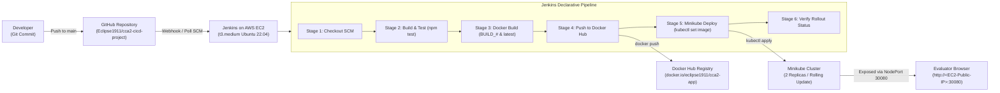

# Cloud Computing & DevOps (CCA-2) CI/CD Project

> **Institution:** MIT World Peace University (MIT-WPU)  
> **Course:** Cloud Computing & DevOps  
> **Assessment:** Continuous Comprehensive Assessment 2 (CCA-2)  
> **Student Name:** Aryan  
> **Repository:** [Eclipse1911/cca2-cicd-project](https://github.com/Eclipse1911/cca2-cicd-project)  

---

## 📋 Executive Summary & System Architecture

This repository hosts a production-grade Cloud Native Web Application and automated CI/CD pipeline built to satisfy all rubrics of the CCA-2 assessment. The system demonstrates end-to-end continuous integration and delivery using **AWS EC2**, **Docker**, **Jenkins**, and **Kubernetes (Minikube)**.



---

## 📂 Repository Layout

```text
├── app/
│   ├── public/
│   │   ├── index.html        # Interactive Cloud & DevOps dashboard UI
│   │   ├── styles.css        # Vanilla CSS styling with glassmorphism & dark theme
│   │   └── app.js            # Telemetry polling, pipeline simulator & quiz logic
│   ├── server.js             # Node.js Express server with health and telemetry APIs
│   └── version.js            # Version source of truth (V1.0 vs V2.0 demo switch)
├── tests/
│   └── server.test.js        # Automated unit tests for API endpoints & version string
├── k8s/
│   ├── deployment.yaml       # K8s Deployment (2 Replicas, resource limits, rolling update)
│   └── service.yaml          # K8s NodePort Service (fixed port 30080)
├── Dockerfile                # Production Docker container definition (Node 20 Alpine)
├── .dockerignore             # Exclusions for lean Docker build context
├── Jenkinsfile               # 6-stage Declarative CI/CD pipeline
├── package.json              # App dependencies & test scripts
├── .gitignore                # Git exclusions
└── README.md                 # Full project documentation & execution guide
```

---

## 🚀 6-Phase Step-by-Step Execution Plan

### Phase 1: Local Application & Repository Setup

1. **Clone the repository:**
   ```bash
   git clone https://github.com/Eclipse1911/cca2-cicd-project.git
   cd cca2-cicd-project
   ```

2. **Install dependencies:**
   ```bash
   npm install
   ```

3. **Execute unit tests:**
   ```bash
   npm test
   ```
   *Output:*
   ```text
   ▶ Cloud Computing & DevOps CI/CD Test Suite
     ✔ 1. GET /api/health should return HTTP 200 with UP status
     ✔ 2. GET /api/version should return valid version string for CI/CD check
     ✔ 3. GET /api/info should return host diagnostics and memory telemetry
     ✔ 4. GET / serves HTML frontend dashboard with responsive web application
   ✔ Cloud Computing & DevOps CI/CD Test Suite
   ℹ pass 4, fail 0
   ```

4. **Run locally:**
   ```bash
   npm start
   ```
   Navigate to `http://localhost:3000` to inspect the application dashboard.

---

### Phase 2: AWS EC2 & Tooling Setup

1. **Launch EC2 Instance:**
   - **AMI:** Ubuntu Server 22.04 LTS (HVM), SSD Volume Type
   - **Instance Type:** `t3.medium` (2 vCPU, 4 GiB RAM required for Minikube + Jenkins)
   - **Storage:** 25 GB gp3 root volume
   - **Security Group Inbound Rules:**
     - SSH: Port `22` (Your IP)
     - Jenkins: Port `8080` (Anywhere `0.0.0.0/0` or Your IP)
     - Application NodePort: Port `30080` (Anywhere `0.0.0.0/0`)
     - HTTP: Port `80` / `3000` (Optional)

2. **Connect via SSH and update system:**
   ```bash
   ssh -i your-key.pem ubuntu@<EC2-PUBLIC-IP>
   sudo apt-get update && sudo apt-get upgrade -y
   ```

3. **Install Docker Engine:**
   ```bash
   sudo apt-get install -y docker.io
   sudo systemctl enable --now docker
   sudo usermod -aG docker $USER
   ```

4. **Install OpenJDK 17 & Jenkins:**
   ```bash
   sudo apt-get install -y fontconfig openjdk-17-jre
   sudo wget -O /usr/share/keyrings/jenkins-keyring.asc https://pkg.jenkins.io/debian-stable/jenkins.io-2023.key
   echo "deb [signed-by=/usr/share/keyrings/jenkins-keyring.asc] https://pkg.jenkins.io/debian-stable binary/" | sudo tee /etc/apt/sources.list.d/jenkins.list > /dev/null
   sudo apt-get update && sudo apt-get install -y jenkins

   # Add jenkins user to docker group
   sudo usermod -aG docker jenkins
   sudo systemctl restart jenkins
   ```

5. **Install Node.js & npm (for Jenkins test runner):**
   ```bash
   curl -fsSL https://deb.nodesource.com/setup_20.x | sudo -E bash -
   sudo apt-get install -y nodejs
   ```

6. **Install `kubectl` and `Minikube`:**
   ```bash
   # kubectl
   curl -LO "https://dl.k8s.io/release/$(curl -L -s https://dl.k8s.io/release/stable.txt)/bin/linux/amd64/kubectl"
   sudo install -o root -g root -m 0755 kubectl /usr/local/bin/kubectl

   # minikube
   curl -LO https://storage.googleapis.com/minikube/releases/latest/minikube-linux-amd64
   sudo install minikube-linux-amd64 /usr/local/bin/minikube

   # Start Minikube as ubuntu user using the Docker driver
   minikube start --driver=docker --listen-address='0.0.0.0'
   ```

7. **Grant Jenkins user access to Minikube & Kubernetes:**
   ```bash
   # Copy kubeconfig to jenkins home directory so Jenkins can run kubectl
   sudo mkdir -p /var/lib/jenkins/.kube
   sudo cp -r /home/ubuntu/.kube/config /var/lib/jenkins/.kube/config
   sudo cp -r /home/ubuntu/.minikube /var/lib/jenkins/.minikube
   sudo chown -R jenkins:jenkins /var/lib/jenkins/.kube /var/lib/jenkins/.minikube
   ```

---

### Phase 3: Dockerfile & Registry Prep

1. **Inspect Dockerfile:**
   Built on `node:20-alpine`, uses non-root `USER node`, multi-stage layer caching, and healthchecks.

2. **Docker Hub Repository:**
   - Log in to [Docker Hub](https://hub.docker.com/).
   - Create a public repository named `cca2-app` (e.g., `docker.io/<your-username>/cca2-app`).

3. **Configure Jenkins Credentials:**
   - In Jenkins Dashboard, go to **Manage Jenkins** → **Credentials** → **System** → **Global credentials (unrestricted)**.
   - Click **Add Credentials**:
     - **Kind:** Username with password
     - **Scope:** Global
     - **Username:** `<your-dockerhub-username>` (e.g. `eclipse1911`)
     - **Password:** `<your-dockerhub-password-or-token>`
     - **ID:** `dockerhub-credentials` *(Must match the ID in Jenkinsfile)*
     - **Description:** Docker Hub Credentials for CCA-2 Pipeline
   - Click **Create**.

---

### Phase 4: Kubernetes Manifests (`k8s/`)

- **`k8s/deployment.yaml` Specifications:**
  - `replicas: 2`: Two active Pods for high availability.
  - `strategy.type: RollingUpdate`: `maxSurge: 1`, `maxUnavailable: 0` ensures zero downtime during code updates.
  - `resources`:
    - Requests: `cpu: 100m`, `memory: 128Mi`
    - Limits: `cpu: 250m`, `memory: 256Mi`
  - `livenessProbe` & `readinessProbe`: Querying `/api/health` on port 3000.

- **`k8s/service.yaml` Specifications:**
  - `type: NodePort`: Exposes the pods outside the Minikube cluster.
  - `nodePort: 30080`: Fixed port matching the AWS Security Group rule.
  - Evaluators can directly access the application via `http://<EC2-Public-IP>:30080`.

> **Note on Minikube NodePort routing on AWS EC2:**  
> Since Minikube runs inside a Docker container on EC2, route EC2 port 30080 to Minikube's NodePort using:
> ```bash
> # Background port forwarder or minikube service tunnel
> kubectl port-forward --address 0.0.0.0 service/cca2-app-service 30080:3000 &
> ```
> *(Or use `socat` / `iptables` / minikube ip routing).*

---

### Phase 5: Declarative Jenkinsfile Pipeline

Create a new **Pipeline** item in Jenkins:
1. Click **New Item** → Name it `cca2-cicd-job` → Select **Pipeline** → Click **OK**.
2. Scroll to the **Pipeline** section:
   - **Definition:** Pipeline script from SCM
   - **SCM:** Git
   - **Repository URL:** `https://github.com/Eclipse1911/cca2-cicd-project.git`
   - **Branch Specifier:** `*/main`
   - **Script Path:** `Jenkinsfile`
3. Click **Save**.

The declarative pipeline executes 6 sequential stages:
1. **Checkout SCM:** Pulls source code from GitHub.
2. **Build & Test:** Executes `npm install` and runs unit tests (`npm test`).
3. **Docker Build:** Builds container image tagged with `${BUILD_NUMBER}` and `latest`.
4. **Push Image:** Securely authenticates via `dockerhub-credentials` and pushes both tags.
5. **Minikube Deploy:** Executes `kubectl apply -f k8s/` and updates the deployment image tag.
6. **Verify Deployment:** Runs `kubectl rollout status` and prints active pods and service details.

---

### Phase 6: Code Change Demo (Rubric Requirement)

This is the primary demonstration required during the viva / evaluation:

#### Step 1: Run Initial Build #1
1. In Jenkins UI, click **Build Now**.
2. Observe all 6 stages passing.
3. Open your browser to `http://<EC2-PUBLIC-IP>:30080`.
4. The dashboard displays the initial version badge:
   ```text
   Version 1.0 - Hello World
   ```

#### Step 2: Edit Source Code
Open [app/version.js](file:///app/version.js) and update `APP_VERSION`:
```javascript
// Comment out Version 1.0:
// const APP_VERSION = 'Version 1.0 - Hello World';

// Uncomment Version 2.0:
const APP_VERSION = 'Version 2.0 - CI/CD Updated!';
```

#### Step 3: Commit & Push Changes
```bash
git add app/version.js
git commit -m "feat(phase-6): upgrade application to Version 2.0 - CI/CD Updated!"
git push origin main
```

#### Step 4: Run Build #2 & Observe Rolling Update
1. Trigger **Build Now** in Jenkins (or let GitHub Webhook trigger it).
2. Watch the Jenkins console output:
   - Automated unit tests run and pass.
   - New Docker image `cca2-app:2` is built and pushed to Docker Hub.
   - Kubernetes executes a rolling update: new Pods are spawned and health-checked before old Pods are terminated.
3. **Refresh the browser** at `http://<EC2-PUBLIC-IP>:30080`:
   - The application live banner immediately reflects:
     ```text
     Version 2.0 - CI/CD Updated!
     ```
   - Zero-downtime rolling update successfully demonstrated!

---

## 🔬 API Endpoints Reference

| Endpoint | Method | Description |
|---|---|---|
| `/` | `GET` | Serves the interactive Cloud Computing & DevOps single-page dashboard |
| `/api/health` | `GET` | Kubernetes Liveness & Readiness probe endpoint returning status `UP` |
| `/api/version` | `GET` | Returns active version string (`Version 1.0` or `Version 2.0`) |
| `/api/info` | `GET` | Returns pod diagnostics, memory telemetry, uptime, and host metadata |

---

## 🛠️ Verification & Troubleshooting Commands

```bash
# Check Docker daemon status
sudo systemctl status docker

# Inspect Minikube cluster status
minikube status

# List active Kubernetes Pods with assigned IPs
kubectl get pods -l app=cca2-app -o wide

# Check Kubernetes Service & NodePort mapping
kubectl get svc cca2-app-service

# Inspect Pod container logs
kubectl logs -l app=cca2-app --tail=50

# Test health endpoint locally on the EC2 machine
curl http://localhost:30080/api/health
```

---

## 🎓 Academic Credit & Submission

- **Student:** Aryan
- **Institution:** MIT World Peace University, Pune
- **Course:** Cloud Computing & DevOps
- **Assessment:** CCA-2
